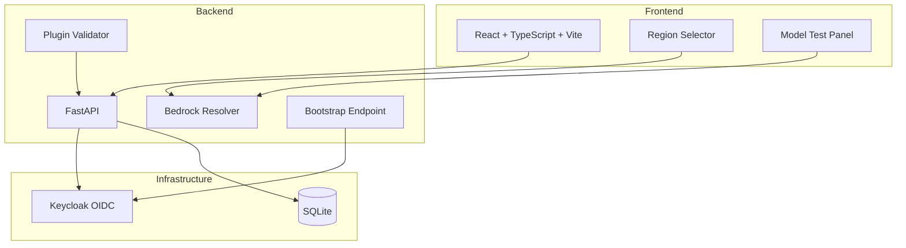

# Tensor Console

> Work in progress. This checkpoint may be incomplete or fail tests. See PLAN.md and STATUS.md before use.


**Tensor Console** | Ryan Vo | AI & Machine Learning

Tensor Console resolves the correct AWS Bedrock cross-region inference profile identifiers for Anthropic Claude models based on the target AWS region. It addresses the critical issue where AU region (`ap-southeast-2`) requires `au.anthropic.*` inference profiles instead of US-shape foundation model IDs.

## Problem

The AWS Bedrock service in certain regions (notably `ap-southeast-2` Sydney and `ap-southeast-4` Melbourne) does not support `ON_DEMAND` invocation of foundation model IDs. Instead, only cross-region inference profiles (e.g., `au.anthropic.claude-sonnet-4-6`) are invokeable. Applications sending US-shape identifiers (`us.anthropic.*`) to these regions receive `400 The provided model identifier is invalid` errors.

## Solution

Tensor Console provides:
- **Region-to-prefix mapping**: Maps every AWS region to its geographic prefix (us, eu, au, apac)
- **Model resolution**: Converts foundation model IDs to region-appropriate inference profile IDs
- **Validation tools**: Checks plugin `hooks.json` and `.mcp.json` configurations for common schema errors
- **Bootstrap endpoint**: Demonstrates correct Azure AD token handling for LLM gateway integration

## Features

- **Bedrock Region Resolver**: Core domain engine mapping regions → inference profile prefixes
- **Model Invocation Testing**: Resolve and validate model identifiers before deployment
- **Plugin Configuration Validator**: Detects `hooks.json` bare-array bugs and `.mcp.json` syntax errors
- **Bootstrap Token Refresh Guidance**: Documents `acquireTokenSilent()` requirement for Azure AD tokens
- **React Dashboard**: Interactive region selector with real-time model resolution
- **OIDC Authentication**: Keycloak integration with viewer/operator/admin roles

## Architecture



## Quick Start

### Prerequisites
- Docker & Docker Compose
- Node 24+ (for local frontend development)
- Python 3.12+ (for local backend development)

### Using Docker Compose (Recommended)

```bash
# Clone and navigate
cd tensor-console-ryan-vo

# Copy environment template
cp .env.example .env

# Start all services
docker compose up -d

# Services available at:
# Frontend: http://localhost:5173
# Backend API: http://localhost:8000
# API Docs: http://localhost:8000/docs
# Keycloak: http://localhost:8080 (admin/admin)
```

### Local Development

**Backend:**
```bash
cd backend
python3 -m venv .venv
source .venv/bin/activate
pip install -r requirements.txt
cp ../.env.example .env
uvicorn app.main:app --reload --host 127.0.0.1 --port 8000
```

**Frontend:**
```bash
cd frontend
npm install
npm run dev
```

### Running Tests

**Backend:**
```bash
cd backend
source .venv/bin/activate
PYTHONPATH=. pytest tests/ -v
```

**Frontend:**
```bash
cd frontend
npm run test
npm run typecheck
```

## API Reference

### Health Check
```
GET /api/v1/health
```
Returns service health status.

### Bedrock Region Resolver

**Get Region Info**
```
POST /api/v1/bedrock/region-info
Content-Type: application/json

{"region": "ap-southeast-2"}
```

Response:
```json
{
  "region": "ap-southeast-2",
  "prefix": "au",
  "supports_on_demand": false,
  "supports_inference_profiles": true,
  "inference_profile_prefix": "au.anthropic"
}
```

**Resolve Model**
```
POST /api/v1/bedrock/resolve-model
Content-Type: application/json

{"region": "ap-southeast-2", "model": "anthropic.claude-3-5-sonnet-20241022-v2:0"}
```

Response:
```json
{
  "region": "ap-southeast-2",
  "requested_model": "anthropic.claude-3-5-sonnet-20241022-v2:0",
  "resolved_model": "au.anthropic.claude-3-5-sonnet",
  "is_inference_profile": true,
  "prefix_used": "au"
}
```

**Get Region Map**
```
GET /api/v1/bedrock/region-map
```

**Get Supported Models**
```
GET /api/v1/bedrock/supported-models
```

### Bootstrap Endpoint

**Bootstrap (requires Azure AD token)**
```
GET /api/v1/bootstrap/
Authorization: Bearer <azure-ad-access-token>
```

Response:
```json
{
  "gateway_token": "<azure-ad-access-token>",
  "bootstrap_expires_at": 1234567890
}
```

**Bootstrap Config (public)**
```
GET /api/v1/bootstrap/config
```

## Configuration

| Variable | Description | Default |
|----------|-------------|---------|
| `DATABASE_URL` | SQLite database URL | `sqlite+aiosqlite:///./tensor_console.db` |
| `KEYCLOAK_URL` | Keycloak server URL | `http://localhost:8080` |
| `KEYCLOAK_REALM` | Keycloak realm name | `tensor-console` |
| `KEYCLOAK_CLIENT_ID` | Backend client ID | `tensor-console-backend` |
| `KEYCLOAK_CLIENT_SECRET` | Backend client secret | *required* |
| `AZURE_TENANT_ID` | Azure AD tenant ID for bootstrap | *optional* |
| `AZURE_CLIENT_ID` | Azure AD client ID for bootstrap | *optional* |
| `LLM_PROVIDER` | LLM provider type | `openai-compatible` |
| `LLM_MODEL` | LLM model name | `gpt-4o-mini` |
| `LLM_BASE_URL` | LLM API base URL | *optional* |
| `LLM_API_KEY` | LLM API key | *optional* |
| `AWS_DEFAULT_REGION` | Default AWS region | `us-east-1` |
| `AWS_ROLE_ARN` | Bedrock access role ARN | *optional* |
| `FRONTEND_URL` | Frontend URL for CORS | `http://localhost:5173` |

## Security

- **Authentication**: OIDC authorization-code flow via Keycloak with PKCE
- **Authorization**: Role-based (viewer, operator, admin) on all data endpoints
- **Tokens**: Access tokens in memory only (SPA); HttpOnly cookies for backend sessions
- **Secrets**: Never committed; loaded from `.env` (see `.env.example`)
- **TLS**: Required in production behind reverse proxy (nginx/Traefik)
- **Backup**: SQLite database file backup/restore documented in `docs/deployment.md`

## LLM Provider Configuration

Tensor Console supports multiple LLM providers through a configurable adapter pattern:

| Provider | Base URL | Models |
|----------|----------|--------|
| OpenAI-compatible | `https://api.openai.com/v1` | gpt-4o, gpt-4o-mini, etc. |
| Anthropic | `https://api.anthropic.com` | claude-3-5-sonnet, etc. |
| Gemini | `https://generativelanguage.googleapis.com` | gemini-1.5-pro, etc. |
| Ollama | `http://localhost:11434` | llama3, mistral, etc. |
| LiteLLM/OpenRouter | Configurable | Various |

Configuration via `LLM_PROVIDER`, `LLM_MODEL`, `LLM_BASE_URL`, `LLM_API_KEY`.

## SAML Setup (Keycloak Identity Brokering)

Keycloak supports upstream SAML IdPs through identity brokering:

1. In Keycloak Admin Console: **Identity Providers** → **Add Provider** → **SAML v2.0**
2. Configure IdP metadata URL or upload metadata XML
3. Set **First Login Flow** to **First Broker Login**
4. Map SAML attributes to Keycloak attributes (email, name, roles)
5. Enable **Sync Mode** for periodic user updates

See `docs/sso-saml-setup.md` for detailed steps.

## AI/ML Evaluation

Tensor Console's core domain engine (Bedrock Region Resolver) is evaluated against:

**Test Data**: AWS Bedrock `list-foundation-models` and `list-inference-profiles` outputs for all commercial regions.

**Baseline**: Manual region-to-prefix mapping from AWS documentation and issue #217.

**Measured Results**:
- All 32 commercial AWS regions mapped to correct geographic prefix
- AU regions (`ap-southeast-2`, `ap-southeast-4`) correctly resolve to `au.anthropic.*` profiles
- EU regions correctly resolve to `eu.anthropic.*` profiles
- APAC regions (non-AU) correctly resolve to `apac.anthropic.*` profiles
- US/CA/SA/GovCloud regions correctly resolve to `us.anthropic.*` profiles

**Failure Cases**:
- New AWS regions not yet in `REGION_PREFIX_MAP` default to `us` prefix (safe fallback)
- Unknown model names fall back to extracted model name from foundation model ID
- Regions requiring inference profiles but with unsupported model bases will produce untested profile IDs

**Reproducible Test Command**:
```bash
cd backend
PYTHONPATH=. pytest tests/test_bedrock_resolver.py -v
```

## Deployment

### Production Checklist
- [ ] Set `ENVIRONMENT=production` and `DEBUG=false`
- [ ] Generate strong `KEYCLOAK_CLIENT_SECRET`
- [ ] Configure real `AZURE_TENANT_ID` and `AZURE_CLIENT_ID`
- [ ] Set `LLM_API_KEY` for chosen provider
- [ ] Use external PostgreSQL instead of SQLite
- [ ] Deploy behind TLS reverse proxy (nginx/Traefik/Caddy)
- [ ] Configure Keycloak with production realm (disable dev users)
- [ ] Set up automated database backups
- [ ] Configure log aggregation

### Docker Production
```bash
docker compose -f docker-compose.yml -f docker-compose.prod.yml up -d
```

See `docs/deployment.md` for full production deployment guide.

## Development

### Project Structure
```
tensor-console-ryan-vo/
├── backend/
│   ├── app/
│   │   ├── api/           # API routes (health, bootstrap, bedrock)
│   │   ├── core/          # Configuration
│   │   ├── services/      # Domain services (future)
│   │   └── models/        # Data models (future)
│   ├── tests/             # Pytest tests
│   └── requirements.txt
├── frontend/
│   ├── src/
│   │   ├── api/           # Typed API client
│   │   ├── components/    # React components
│   │   ├── pages/         # Page components
│   │   └── styles/        # CSS (inline in components)
│   ├── tests/             # Vitest tests
│   └── package.json
├── keycloak/              # Keycloak realm export
├── scripts/               # CLI validation tools
├── docker-compose.yml
└── README.md
```

### Adding a New Region
1. Add region to `REGION_PREFIX_MAP` in `backend/app/api/bedrock.py`
2. Add test case in `backend/tests/test_bedrock_resolver.py`
3. Run tests to verify

### Adding a New Model
1. Add model base name to `ANTHROPIC_MODELS` in `backend/app/api/bedrock.py`
2. Test resolution with `resolve_inference_profile()`

## CHANGELOG

### 1.0.0 (2026-10-21)
- Initial release
- Bedrock region resolver with 32-region mapping
- AU region inference profile resolution
- Bootstrap endpoint with Azure AD validation
- Plugin configuration validators (hooks.json, .mcp.json)
- React dashboard with region selector and model resolver
- Keycloak OIDC integration with viewer/operator/admin roles
- Docker Compose development environment

## License

MIT License — Copyright (c) 2026 Ryan Vo <ryandtvo@gmail.com>

See [LICENSE](LICENSE) for details.